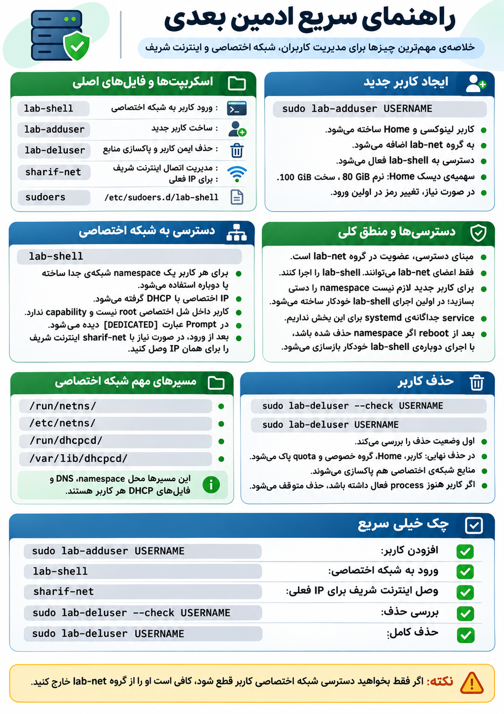

# DL Lab Linux Tools

Administration tools and a handover reference for the Deep Learning Laboratory at Sharif University of Technology. The tools cover local Linux accounts, home-directory quotas, and optional dedicated network access on a shared lab server.

## Commands

| Command | Purpose | Installed path |
| --- | --- | --- |
| `lab-adduser` | Create a local account and home, set its quota, expire the initial password, and add the user to `lab-net`. | `/usr/local/sbin/lab-adduser` |
| `lab-deluser` | Check whether a lab account can be removed, then remove the account and its resources when explicitly run without `--check`. | `/usr/local/sbin/lab-deluser` |
| `lab-shell` | Open an unprivileged shell in the user's dedicated network namespace. | `/usr/local/sbin/lab-shell` |
| `lab-quota-status` | Show local `/home` quota usage, limits, and the reported grace period. | `/usr/local/bin/lab-quota-status` |
| `sharif-net` | Authenticate the current shell's IPv4 source address with the university portal and manage sessions for the signed-in university account. | `/usr/local/bin/sharif-net`, with `/usr/local/lib/sharif-net/core.py` |

## Account workflow

1. Run `sudo lab-adduser USERNAME`. Active user quotas on `/home` and an existing `lab-net` group are required. The script assigns an **80 GiB soft limit** and **100 GiB hard limit**, forces a password change at first login, and enrolls the account in `lab-net`. The grace period is governed by filesystem quota policy. If creation stops after `adduser` succeeds, check quotas and group membership before handing over the account.
2. Before removing an account, arrange for the user to sign out, preserve any needed data, and run `sudo lab-deluser --check USERNAME`. Review its output before running `sudo lab-deluser USERNAME`. The removal workflow deletes the home and clears the lab resources for that account.

## Optional dedicated network

Use the regular login shell for shared networking. Members of `lab-net` can run `lab-shell` to use a separate IPv4 route for that shell and its child processes. At first use, it creates a per-user Linux network namespace and obtains a DHCP lease through an L2 IPvlan interface attached to the host's campus uplink. An existing namespace is reused. After a reboot, the next `lab-shell` invocation reconstructs it on demand. Exit the dedicated shell to return to the shared shell. Removing group membership blocks new `lab-shell` launches. Existing dedicated shells must exit separately.

Run `sharif-net` from the shell whose source address you want to authenticate and verify that its displayed IP is the intended one. An authentication or disconnect action on the shared source IP can affect other users of that IP. The menu also includes account-wide disconnect. Optional saved portal passwords are plaintext in `~/.config/sharif-net/credentials.json`, protected by local file permissions. Leave credential saving off on shared systems unless lab policy allows it.

## Dependencies and checks

- **Accounts and quota:** Debian/Ubuntu `adduser`, shadow account tools, Bash, and Linux quota tools. Check the mount and quota state with `findmnt /home`, `sudo quotaon -p -u /home`, `sudo quota -u USERNAME -s`, and `id USERNAME`.
- **Dedicated network:** Linux network namespaces and IPvlan, `iproute2`, `dhcpcd`, `sudo`, and util-linux (`flock` and `setpriv`). The campus uplink must allow IPvlan traffic and provide DHCP and reachable DNS. Check `ip netns list` and, from the shell in question, `ip -4 route get 1.1.1.1`. The launcher requires a root-owned `/etc/netns/` directory with mode `0755` for per-namespace DNS overrides. Runtime namespace handles are under `/run/netns/`, with DHCP runtime and lease files under `/run/dhcpcd/` and `/var/lib/dhcpcd/`.
- **Sharif portal:** Python 3, `questionary`, `rich`, `iproute2`, and working HTTPS access to the university portal. Portal changes can affect login or session management. Check connectivity and the source route from the intended shell first.

Keep deployment scripts and `/etc/sudoers.d/lab-shell` root-owned. Validate the sudoers configuration with `sudo visudo -c` and limit the grant to the intended command and group.

## Public archive

Archived files mirror their installed paths. Obtain `lab-shell` and `lab-quota-status` through the lab's administrative handover. Their deployed copies contain site-specific network or account identifiers. The deletion script and sudoers rule are available from the lab administrator's private handover.

## Quick guide in Persian

